<p align="center">
  
</p>

<p align="center">
  <a href="#quick-start"><b>Quick start</b></a> ·
  <a href="#features"><b>Features</b></a> ·
  <a href="#screenshots"><b>Screenshots</b></a> ·
  <a href="#connect-an-ai-assistant"><b>Connect an AI</b></a> ·
  <a href="#architecture"><b>Architecture</b></a> ·
  <a href="#development"><b>Development</b></a>
</p>

<p align="center">
  
  
  
  
  
  
</p>

<p align="center">
  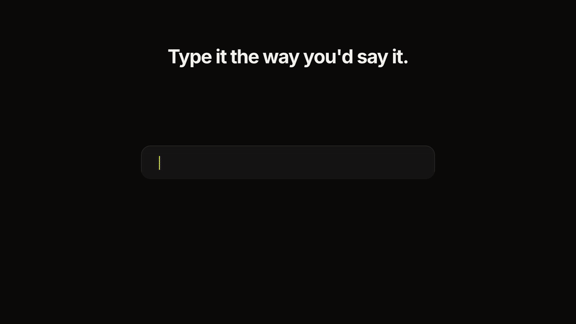
  <br>
  <sub>Want to see the real app? Here's a <a href="docs/readme/walkthrough.mp4">20-second screen recording</a>.</sub>
</p>

## What is MoFin?

MoFin (**Mo**nitor your **Fin**ances) is a personal finance app for people who want their numbers to be right.

Write a purchase the way you'd say it ("coffee with Sam, 4.50"), fill in a form, or ask Claude or ChatGPT to log it for you. Anything an assistant adds shows up as a **draft**, and your balances don't change until you approve it.

MoFin never saves a balance. It adds each one up from your transactions when you look, so the number always matches what you actually logged.

There's a NestJS API, a Next.js web app and an Expo app for Android.

<p align="center">
  
</p>

## Features

<table>
  <tr>
    <td width="50%" valign="top">
      <h3>Talk to it, then approve</h3>
      <p>Describe a purchase in a sentence. MoFin parses it into a draft with an amount, account, category and a confidence score. Approve it as is, or open <b>Review &amp; edit</b> first. Drafts from Claude or ChatGPT show up in the same queue.</p>
    </td>
    <td width="50%">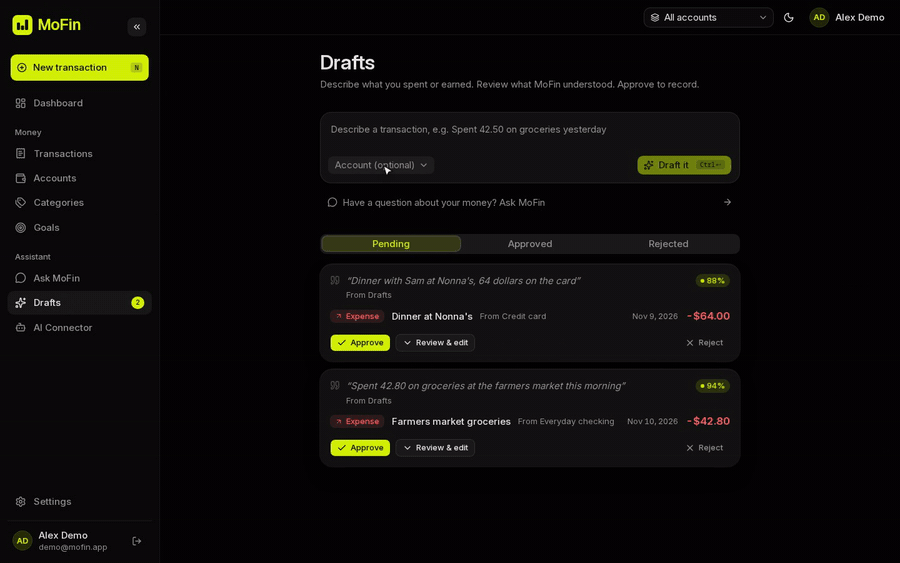</td>
  </tr>
  <tr>
    <td width="50%">
      <picture>
        <source media="(prefers-color-scheme: light)" srcset="docs/readme/screens/dashboard-desktop-light.png">
        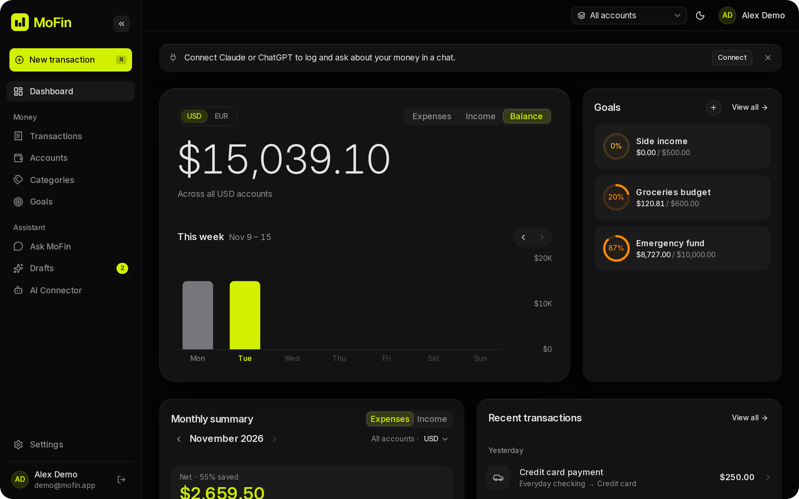
      </picture>
    </td>
    <td width="50%" valign="top">
      <h3>A dashboard that answers "how am I doing?"</h3>
      <p>Total balance per currency, a week-by-week chart you can flip between expenses, income and balance, a monthly summary with a category donut, and your goals at a glance. Use the account switcher to focus on one account or see them all.</p>
    </td>
  </tr>
  <tr>
    <td width="50%" valign="top">
      <h3>Goals that track themselves</h3>
      <p>Savings targets, income goals and spending caps per category. Progress comes straight from your transactions. Each goal resets when its period ends and keeps a history of past periods. A goal that falls behind moves to <b>Needs attention</b>.</p>
    </td>
    <td width="50%">
      <picture>
        <source media="(prefers-color-scheme: light)" srcset="docs/readme/screens/goals-desktop-light.png">
        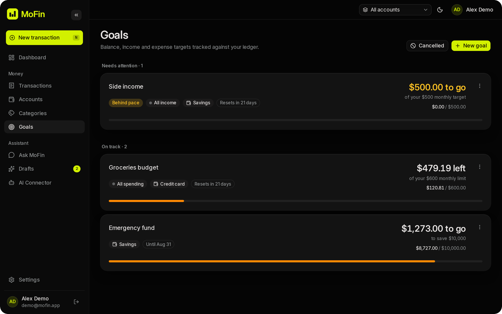
      </picture>
    </td>
  </tr>
  <tr>
    <td width="50%">
      <picture>
        <source media="(prefers-color-scheme: light)" srcset="docs/readme/screens/ask-desktop-light.png">
        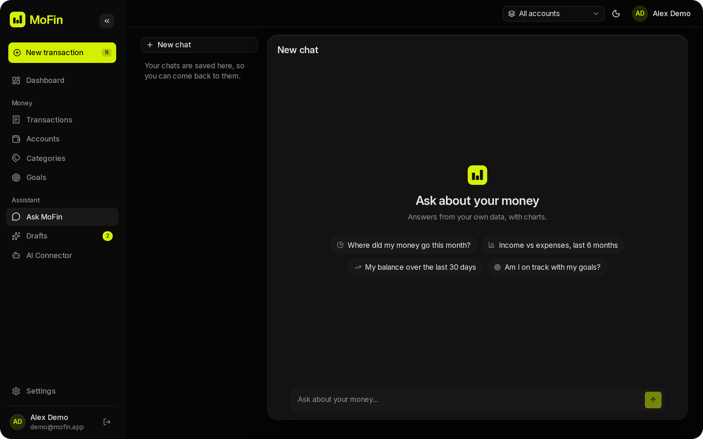
      </picture>
    </td>
    <td width="50%" valign="top">
      <h3>Ask about your money</h3>
      <p><b>Ask MoFin</b> answers questions from your own data, with charts: "Where did my money go this month?", "Am I on track with my goals?". Bring your own AI provider key in Settings (it's encrypted with AES-256-GCM), or use the shared one.</p>
    </td>
  </tr>
</table>

### Everything else

| | |
| --- | --- |
| **Accounts** | Bank, cash, savings and more, in any currency, with an opening balance. Archive old ones instead of deleting them. |
| **Shared accounts** | Invite someone to an account by email, with roles. You can also hand ownership over. |
| **Transactions** | Income, expenses and transfers. Split one across categories, edit it, or delete it with undo. |
| **Recurring payments** | Pause and resume them. If one can't go through, it pauses itself and tells you why. |
| **Search** | Search descriptions, plus date, account, category and type filters. |
| **AI connector** | One-click setup for Claude, ChatGPT and Gemini over MCP with OAuth 2.1. |
| **Android app** | Expo app covering the core of the web app, with Google sign-in and push notifications for new drafts. |
| **Your data** | Export to JSON or CSV. Delete your data or your whole account. |
| **Sign-in** | Email and password with verification, or Google. Password reset, and sign out everywhere. |
| **Accessibility** | axe checks in the E2E suite, real touch targets, and text alternatives for charts. |
| **Light and dark** | Both themes everywhere, with a lime-on-ink palette. |

## Screenshots

<p align="center">
  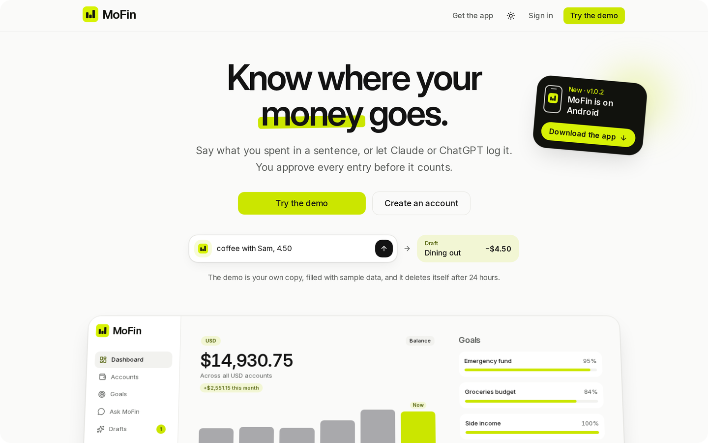
</p>

<table>
  <tr>
    <td width="50%">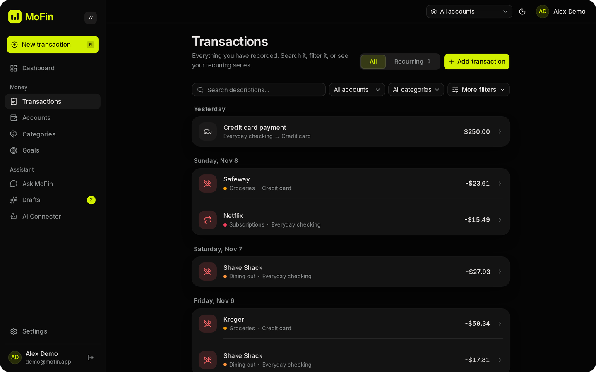<p align="center"><sub><b>Transactions</b>: grouped by day, searchable</sub></p></td>
    <td width="50%">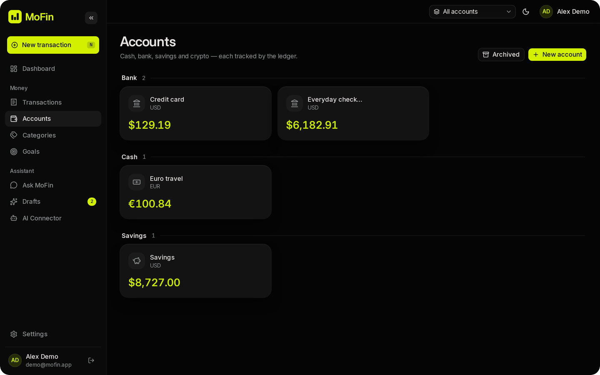<p align="center"><sub><b>Accounts</b>: each balance is added up from its transactions</sub></p></td>
  </tr>
  <tr>
    <td width="50%">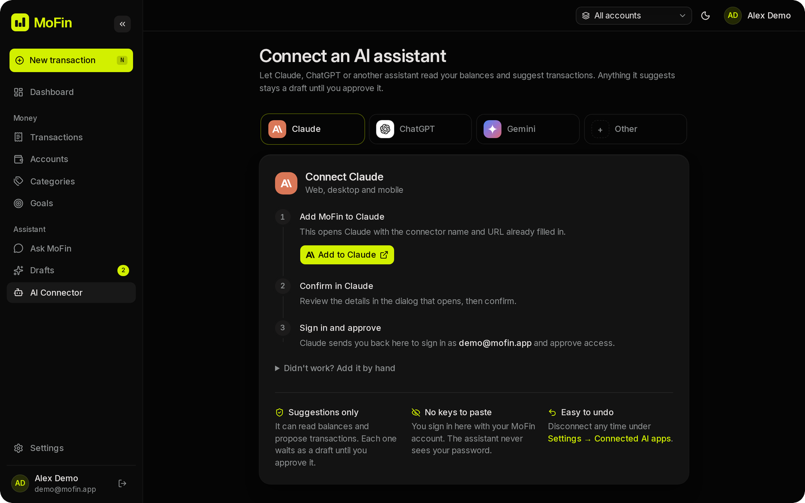<p align="center"><sub><b>AI connector</b>: Claude, ChatGPT, Gemini or any MCP client</sub></p></td>
    <td width="50%">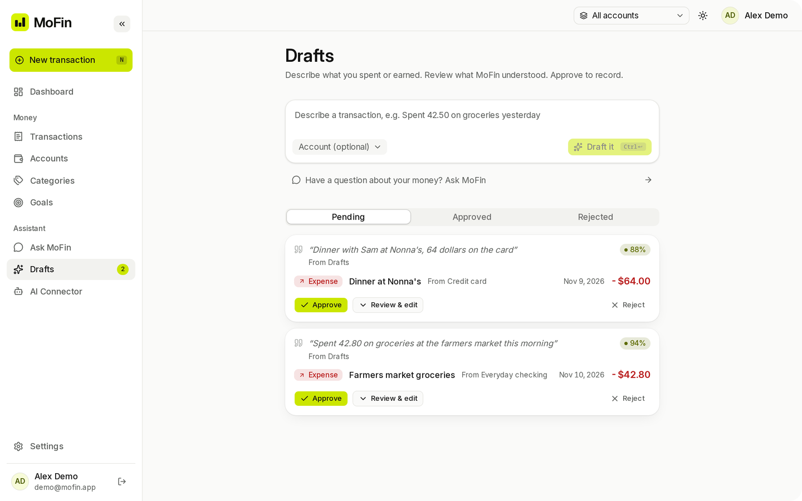<p align="center"><sub><b>Drafts</b>: light mode</sub></p></td>
  </tr>
</table>

<p align="center">
  <picture>
    <source media="(prefers-color-scheme: light)" srcset="docs/readme/screens/mobile-light.png">
    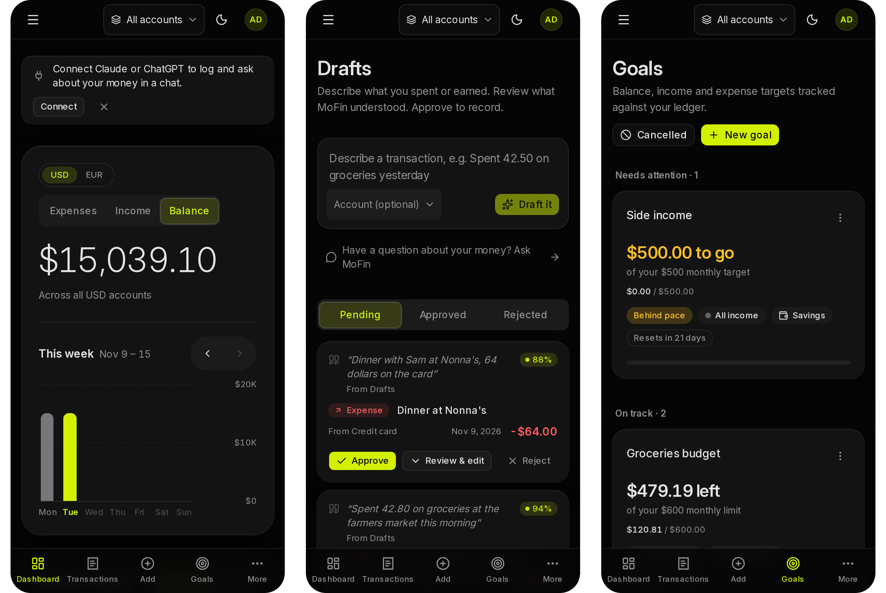
  </picture>
  <br>
  <sub>The web app on a phone, with its bottom navigation</sub>
</p>

## Quick start

You only need Docker with Compose. From the repository root:

```bash
docker compose up --build
```

Then open **http://localhost:3001** and sign in with the demo account:

| Email | Password |
| --- | --- |
| `demo@mofin.app` | `DemoPassw0rd!` |

The demo has four accounts in USD and EUR, about three months of transactions and three goals.

> [!TIP]
> `docker compose down -v` stops everything and deletes the database; the next start seeds it again. Change the host ports with `API_PORT` and `WEB_PORT` (3000 and 3001 by default). A `.env` file is optional: the root `.env.example` holds demo-only defaults.

<details>
<summary><b>Run without Docker</b></summary>
<br>

You need Node.js 20.9 or newer and PostgreSQL 16. The backend has its own Compose file that starts only Postgres on port 5432.

**API** on http://localhost:3000 (Swagger UI at `/docs` in development):

```bash
cd backend
docker compose up -d            # PostgreSQL only
cp .env.example .env
npm ci
npx prisma migrate deploy
npx prisma db seed              # demo data; add `-- --reset` to recreate it
npm run start:dev
```

**Web** on http://localhost:3001:

```bash
cd frontend/web
cp .env.example .env.local      # nothing is required in development
npm ci
npm run dev
```

The web app falls back to `BACKEND_URL=http://localhost:3000/api/v1`.

**Android app**: see [`docs/mobile/README.md`](docs/mobile/README.md) and [`docs/mobile/RELEASING-APK.md`](docs/mobile/RELEASING-APK.md).

The seed is idempotent, and it refuses to run in production unless `ALLOW_DEMO_SEED=true`.

</details>

## Connect an AI assistant

MoFin runs an MCP server behind its own OAuth 2.1 authorization server. Any MCP client can connect to it, and the **AI Connector** page in the app walks you through Claude, ChatGPT and Gemini step by step.

```text
MCP URL   http://localhost:3000/api/v1/mcp
```

| Tool | What it does |
| --- | --- |
| `create_draft_transaction` | Proposes a transaction. It waits as a draft until you approve it. |
| `search_transactions` | Searches by text, date, account, category and type. |
| `get_balance` | Balances per account and currency, added up from transactions. |
| `get_monthly_summary` | Income, expenses and net for a month, by category. |
| `list_accounts` · `list_categories` | Gives the assistant what it needs to fill a draft correctly. |
| `list_goals` · `get_goal` · `get_goal_history` | Goal progress and past periods. |

There's deliberately no tool that writes a transaction directly.

## Architecture

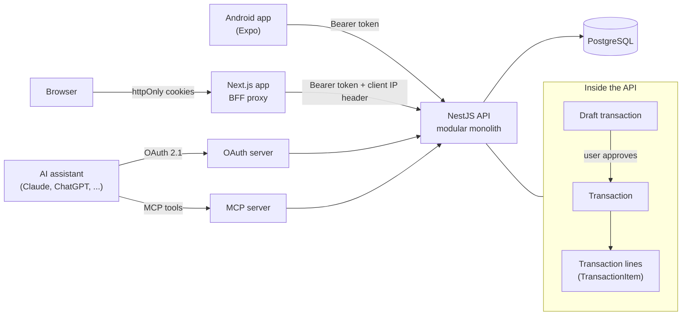

<table>
  <tr>
    <td width="50%" valign="top">
      <b>Balances are sums, not saved numbers</b><br>
      Every balance is a SQL sum over transaction lines (<code>TransactionItem</code>), so it can't drift away from them. Money is a decimal everywhere, never a float.
    </td>
    <td width="50%" valign="top">
      <b>Assistants only draft</b><br>
      An assistant can't save a transaction. The only way in is draft, then your approval, then the transaction.
    </td>
  </tr>
  <tr>
    <td width="50%" valign="top">
      <b>Backend for frontend</b><br>
      The browser never sees a token. Next.js keeps them in httpOnly cookies and forwards calls through <code>app/api/backend/[...path]</code>. Refresh tokens rotate, and reuse is detected.
    </td>
    <td width="50%" valign="top">
      <b>Modular monolith</b><br>
      One NestJS app split into modules (accounts, transactions, goals, search, mcp, oauth, ai and more). They talk through services and events, so one can be split out later.
    </td>
  </tr>
  <tr>
    <td width="50%" valign="top">
      <b>Separate trust zones</b><br>
      MCP tokens are signed with a different secret from web tokens. The MCP layer calls application services and never touches Prisma directly.
    </td>
    <td width="50%" valign="top">
      <b>UI-only clients</b><br>
      The web and mobile apps hold no business rules of their own. The mobile app keeps a copy of the web's pure helpers, and a drift script flags any difference.
    </td>
  </tr>
</table>

<details>
<summary><b>Project structure</b></summary>
<br>

```text
backend/                 NestJS API, Prisma schema and migrations
  src/modules/           accounts, account-access, account-sharing, ai, analytics, auth,
                         categories, draft-transactions, export, goals, ledger, mail, mcp,
                         notifications, oauth, search, transactions, users, ...
  prisma/                schema.prisma, migrations and the demo seed
  test/                  e2e tests
frontend/web/            Next.js 16 app (UI and BFF)
  app/                   routes, including app/api/backend and app/api/auth
  e2e/                   Playwright tests with axe checks
frontend/mobile/         Expo app for Android (iOS later)
docs/                    mobile notes and README media
```

</details>

## Development

### Tests

| Suite | Where | Command |
| --- | --- | --- |
| API unit (Jest, 71 spec files) | `backend/` | `npm test` |
| API e2e (some need `E2E_DATABASE_URL`) | `backend/` | `npm run test:e2e` |
| Web unit (Vitest, 75 files) | `frontend/web/` | `npm test` |
| Web E2E (Playwright + axe, 35 specs) | `frontend/web/` | `npm run e2e:seed && npx playwright test` |
| Mobile (Jest, 97 files) | `frontend/mobile/` | `npm test` |

Playwright needs the API on :3000 and the web app on :3001. Run `npx playwright install chromium` once beforehand.

### Environment variables

Defaults and examples are in `backend/.env.example`, `frontend/web/.env.example` and the root `.env.example` (Docker).

<details>
<summary><b>Full reference</b></summary>
<br>

| Name | App | Required | Purpose |
| --- | --- | --- | --- |
| `DATABASE_URL` | backend | yes | PostgreSQL connection string. |
| `JWT_ACCESS_SECRET` | backend | yes | Signs web access tokens. Placeholder values are rejected at startup. |
| `JWT_MCP_SECRET` | backend | yes | Signs MCP and OAuth access tokens. Must differ from `JWT_ACCESS_SECRET`. |
| `REFRESH_TOKEN_SECRET` | backend | yes | Derives rotated refresh tokens. Any random value of 32 or more characters. |
| `JWT_ACCESS_TTL`, `JWT_REFRESH_TTL` | backend | no | Token lifetimes (`15m`, `30d`). |
| `PORT` | backend | no | API port (3000). |
| `OAUTH_ISSUER` | backend | yes | Public base URL of the API. Must match the token issuer. |
| `OAUTH_RESOURCE_URI` | backend | no | MCP resource URL. Defaults to `${OAUTH_ISSUER}/api/v1/mcp`. |
| `WEB_URL` | backend | yes | Web app URL, used by the OAuth login bridge and email links. |
| `GOOGLE_CLIENT_ID`, `GOOGLE_CLIENT_SECRET`, `GOOGLE_TOKEN_URL` | backend | no | Google sign-in. Without them `/auth/google` returns 503. |
| `GOOGLE_MOBILE_CLIENT_IDS` | backend | no | Native Google sign-in from the mobile app: comma-separated client ids accepted as the ID token audience. Without it `/auth/google/id-token` returns 503. |
| `SMTP_HOST`, `SMTP_PORT`, `SMTP_SECURE`, `SMTP_USER`, `SMTP_PASS`, `MAIL_FROM` | backend | no | Outgoing email. Without `SMTP_HOST`, emails are logged outside production. |
| `PASSWORD_RESET_TTL` | backend | no | Reset link lifetime (`30m`). |
| `MAIL_CAPTURE_DIR` | backend | no | Development and test only. Writes emails as JSON files for the E2E suite. |
| `AI_API_KEY`, `AI_BASE_URL`, `AI_MODEL`, `AI_TIMEOUT_MS` | backend | no | The shared assistant (Groq by default). Without `AI_API_KEY`, drafts use the local parser and chat answers 503, unless a person stores their own key. |
| `AI_KEY_ENCRYPTION_KEY` | backend | production | 32 random bytes, base64 (`openssl rand -base64 32`). Encrypts the AI provider keys people store, with AES-256-GCM. Losing it makes those keys unreadable but never exposes them. |
| `EXPO_PUSH_ENABLED`, `EXPO_ACCESS_TOKEN` | backend | no | Push notifications to the mobile app through Expo. Off by default: pushes are only logged. |
| `SENTRY_DSN` | backend | no | Error reporting. |
| `BFF_SHARED_SECRET` | backend, web | production | Lets the API trust the client IP header sent by the BFF. Used for rate limiting. |
| `DEMO_PASSWORD` | backend | no | Overrides the demo user's password in the seed. |
| `ALLOW_DEMO_SEED` | backend | no | Set to `true` to allow the demo seed in production. |
| `COOKIE_SECURE` | web | no | The `Secure` flag on auth cookies. Set it to `false` when serving over plain HTTP in Docker. |
| `BACKEND_URL` | web | no | API base URL (default `http://localhost:3000/api/v1`). |
| `NEXT_PUBLIC_MCP_URL` | web | no | MCP URL shown on the Connect page. |
| `GOOGLE_CLIENT_ID`, `GOOGLE_AUTH_URL`, `GOOGLE_REDIRECT_URI`, `GOOGLE_SCOPES` | web | no | Google sign-in redirect. |
| `NEXT_PUBLIC_SENTRY_DSN`, `SENTRY_DSN` | web | no | Error reporting. |
| `API_PORT`, `WEB_PORT` | Docker | no | Host ports for the Compose stack. |

</details>

## Security

- Web tokens live in httpOnly cookies, so browser code never handles them.
- Refresh tokens rotate on every use, and reusing an old one is detected.
- Rate limits apply per email, per token and per user, keyed on the real client IP. The BFF sends that IP in a header protected by a shared secret.
- A global auth guard makes every route private unless it's marked `@Public()`.
- Startup validation rejects placeholder secrets.
- AI provider keys that people store are encrypted at rest.
- A gitleaks scan of the full history comes back clean.

## License

All rights reserved.

<p align="center">
  <br>
  
  <br>
  <sub><b>MoFin</b> · Know where your money goes.</sub>
</p>
