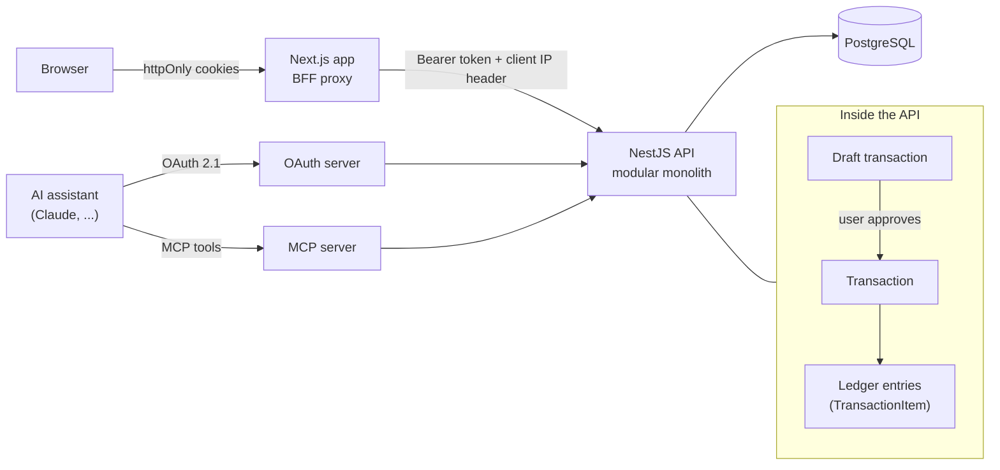

# MoFin

A personal finance app with a ledger-first backend and an MCP server, so AI assistants can draft transactions that you approve.

<!--
Demo GIF placeholder. To record it:
1. Start the stack (see "Quick start") and sign in as the demo user.
2. Record 20-30 seconds at about 1280x720 with a screen recorder such as Peek, LICEcap or ScreenToGif:
   dashboard -> add a transaction -> open Goals -> approve an AI draft.
3. Keep it under 5 MB (reduce the frame rate to 10-12 fps if needed) and save it as docs/demo.gif.
-->


## Features

- **Accounts.** Multi-currency accounts, opening balance, archive.
- **Transactions.** Income, expense and transfer. Split across categories, edit, soft delete with undo. Recurring series that you can pause and resume. A series that cannot post is paused with the reason shown.
- **Categories.** Default categories for new users. Archive instead of delete.
- **Goals.** Balance, income and expense goals. Recurring periods and a history of finished periods.
- **Dashboard.** Balance chart, monthly summary and a category donut.
- **Search and filters.** Full transaction search with date, account, category and type filters.
- **AI drafts.** AI assistants connect over MCP and create drafts. You review and approve each one.
- **Account tools.** Data export (JSON and CSV), account deletion, password reset, change password, sign out everywhere.
- **Sign-in.** Email and password, or Google.
- **Quality.** Rate limiting, and accessibility work (axe checks in the E2E suite, touch targets, chart text alternatives).

## Quick start (Docker)

You need Docker with Compose. From the repository root:

```bash
docker compose up --build
```

Then open http://localhost:3001 and sign in with the [demo account](#demo-account).

- `docker compose down -v` stops everything and deletes the database. The next start seeds it again.
- Change the host ports with `API_PORT` and `WEB_PORT` (defaults 3000 and 3001).
- The root `.env.example` has demo-only defaults. A `.env` file is optional.

## Run without Docker

You need Node.js 20.9 or newer and a PostgreSQL 16 database. The backend ships a Compose file that starts only Postgres on port 5432.

Backend (API on http://localhost:3000, Swagger UI at `/docs` in development):

```bash
cd backend
docker compose up -d            # PostgreSQL only
cp .env.example .env
npm ci
npx prisma migrate deploy
npx prisma db seed              # optional demo data
npm run start:dev
```

Web (http://localhost:3001):

```bash
cd frontend/web
npm ci
npm run dev
```

The web app has no required variables. It falls back to `BACKEND_URL=http://localhost:3000/api/v1`. To override a value, create `frontend/web/.env.local` (see the environment table).

## Demo account

The seed creates a user with four accounts (USD and EUR), about three months of generated transactions and three goals.

| Email | Password |
| --- | --- |
| `demo@mofin.app` | `DemoPassw0rd!` |

The seed is idempotent. `npx prisma db seed -- --reset` recreates the demo data. It refuses to run in production unless `ALLOW_DEMO_SEED=true`.

## Architecture



Key design decisions:

- **Ledger-first.** Balances are never stored. They are computed from ledger entries (`TransactionItem`) with SQL aggregation, so they cannot drift from the transactions.
- **Backend for frontend (BFF).** The browser never sees a token. The Next.js app keeps the access and refresh tokens in httpOnly cookies and forwards API calls through `app/api/backend/[...path]`. Auth routes live under `app/api/auth/*`. Refresh tokens rotate, and reuse of an old token is detected.
- **Draft safety.** AI assistants cannot create real transactions. They create drafts. The flow is draft, approval, transaction, ledger entries.
- **Modular monolith.** One deployable NestJS app split into modules (accounts, transactions, ledger, goals, search, mcp, oauth and others). Modules call each other through services, so a module can be split out later.
- **MCP with OAuth 2.1.** The MCP server (`backend/src/modules/mcp/`) sits behind an OAuth 2.1 authorization server (`backend/src/modules/oauth/`). MCP tokens use a separate signing secret from web tokens.
- **UI only on the web side.** The web app has no business logic of its own. Money is handled as decimals, not floats.

## Project structure

```text
backend/               NestJS API, Prisma schema and migrations
  src/modules/         accounts, auth, categories, draft-transactions, export,
                       goals, ledger, mcp, oauth, search, transactions, users, ...
  prisma/              schema.prisma and migrations
  test/                e2e tests
frontend/web/          Next.js app (UI and BFF)
  app/                 routes, including app/api/backend and app/api/auth
  e2e/                 Playwright tests
docs/                  demo GIF
```

## Environment variables

Defaults and examples are in `backend/.env.example`. Values marked "open PR" are not on `main` yet.

| Name | App | Required | Purpose |
| --- | --- | --- | --- |
| `DATABASE_URL` | backend | yes | PostgreSQL connection string. |
| `JWT_ACCESS_SECRET` | backend | yes | Signs web access tokens. Placeholder values are rejected at startup. |
| `JWT_MCP_SECRET` | backend | yes | Signs MCP and OAuth access tokens. Must differ from `JWT_ACCESS_SECRET`. |
| `REFRESH_TOKEN_SECRET` | backend | yes | Derives rotated refresh tokens. Any random value of 32 or more characters. |
| `JWT_ACCESS_TTL`, `JWT_REFRESH_TTL` | backend | no | Token lifetimes (`15m`, `30d`). |
| `PORT` | backend | no | API port (3000). |
| `OAUTH_ISSUER` | backend | yes | Public base URL of the API. Must match the token issuer. |
| `OAUTH_RESOURCE_URI` | backend | no | MCP resource URL. Defaults to `${OAUTH_ISSUER}/api/v1/mcp`. |
| `WEB_URL` | backend | yes | Web app URL, used by the OAuth login bridge and email links. |
| `GOOGLE_CLIENT_ID`, `GOOGLE_CLIENT_SECRET`, `GOOGLE_TOKEN_URL` | backend | no | Google sign-in. Without them `/auth/google` returns 503. |
| `SMTP_HOST`, `SMTP_PORT`, `SMTP_SECURE`, `SMTP_USER`, `SMTP_PASS`, `MAIL_FROM` | backend | no | Outgoing email for password reset. Without `SMTP_HOST`, emails are logged outside production. |
| `PASSWORD_RESET_TTL` | backend | no | Reset link lifetime (`30m`). |
| `MAIL_CAPTURE_DIR` | backend | no | Development and test only. Writes emails as JSON files for the E2E suite. |
| `SENTRY_DSN` | backend | no | Error reporting. |
| `BFF_SHARED_SECRET` | backend, web | open PR #128 | Shared secret that lets the API trust the client IP header sent by the BFF. Used for rate limiting. |
| `DEMO_PASSWORD` | backend | open PR #130 | Overrides the demo user's password in the seed. |
| `ALLOW_DEMO_SEED` | backend | open PR #130 | Set to `true` to allow the demo seed in production. |
| `COOKIE_SECURE` | web | open PR #133 | Controls the `Secure` flag on auth cookies. Needed when serving over plain HTTP in Docker. |
| `BACKEND_URL` | web | no | API base URL (default `http://localhost:3000/api/v1`). |
| `NEXT_PUBLIC_MCP_URL` | web | no | MCP URL shown on the Connect page. |
| `GOOGLE_CLIENT_ID`, `GOOGLE_AUTH_URL`, `GOOGLE_REDIRECT_URI`, `GOOGLE_SCOPES` | web | no | Google sign-in redirect. |
| `NEXT_PUBLIC_SENTRY_DSN`, `SENTRY_DSN` | web | no | Error reporting. |
| `API_PORT`, `WEB_PORT` | Docker | open PR #133 | Host ports for the Compose stack. |

## Testing

Backend (`cd backend`):

```bash
npm test             # Jest unit tests
npm run test:e2e     # e2e tests; some need E2E_DATABASE_URL
npm run lint
```

Web (`cd frontend/web`):

```bash
npm test             # Vitest
npm run lint
npx playwright install chromium   # once
npm run e2e:seed                  # creates the fixture user
npx playwright test               # needs the backend on :3000 and the web app on :3001
```

## Security

- Tokens live in httpOnly cookies. The browser never handles them.
- Refresh tokens rotate on use, and reuse of a rotated token is detected.
- Rate limits apply per email, per token and per user. They are keyed on the real client IP, which the BFF passes in a header protected by a shared secret.
- A global auth guard makes every route private unless it is marked `@Public()`.
- Startup validation rejects placeholder secrets.
- A gitleaks scan of the full history is clean.

## License

All rights reserved.
